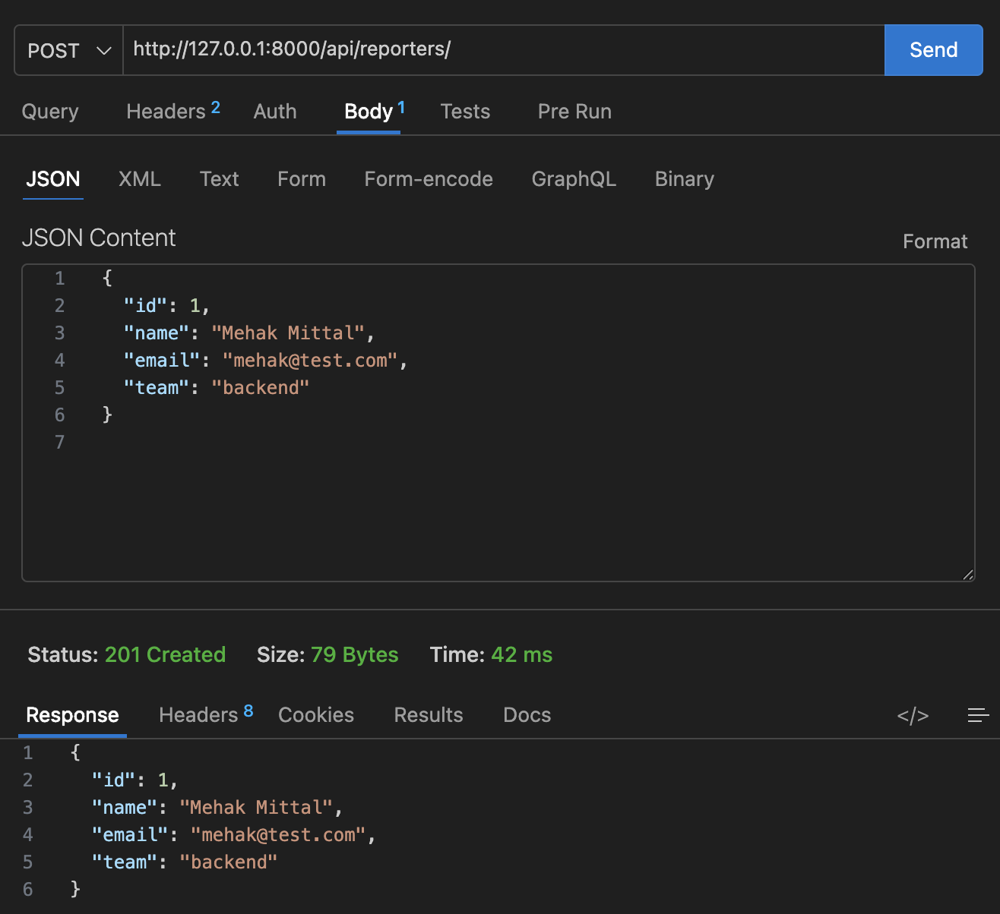
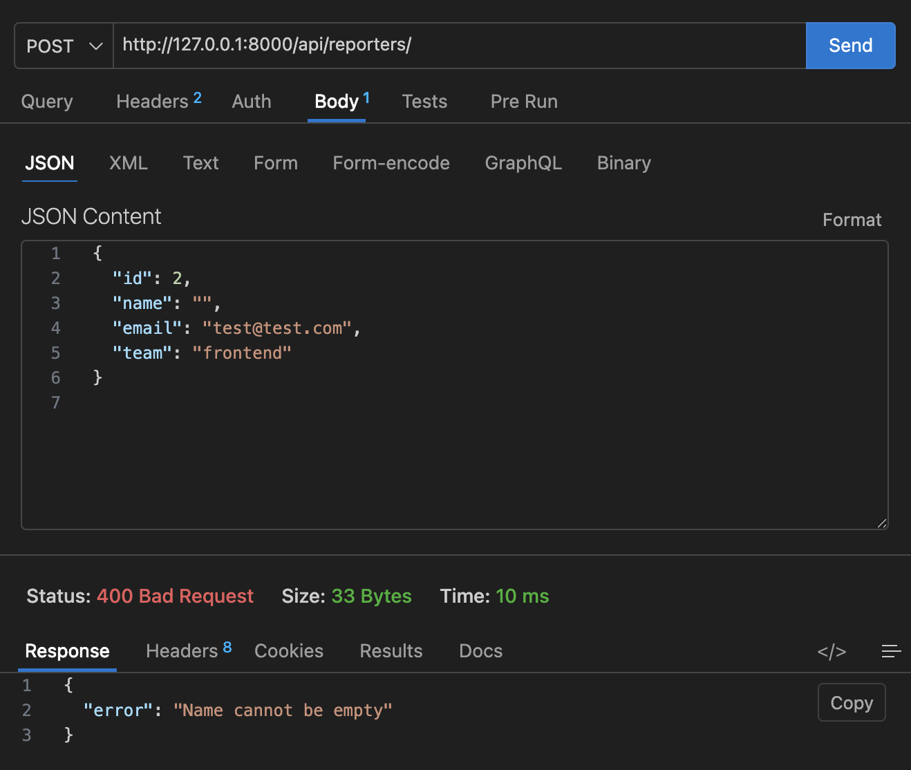
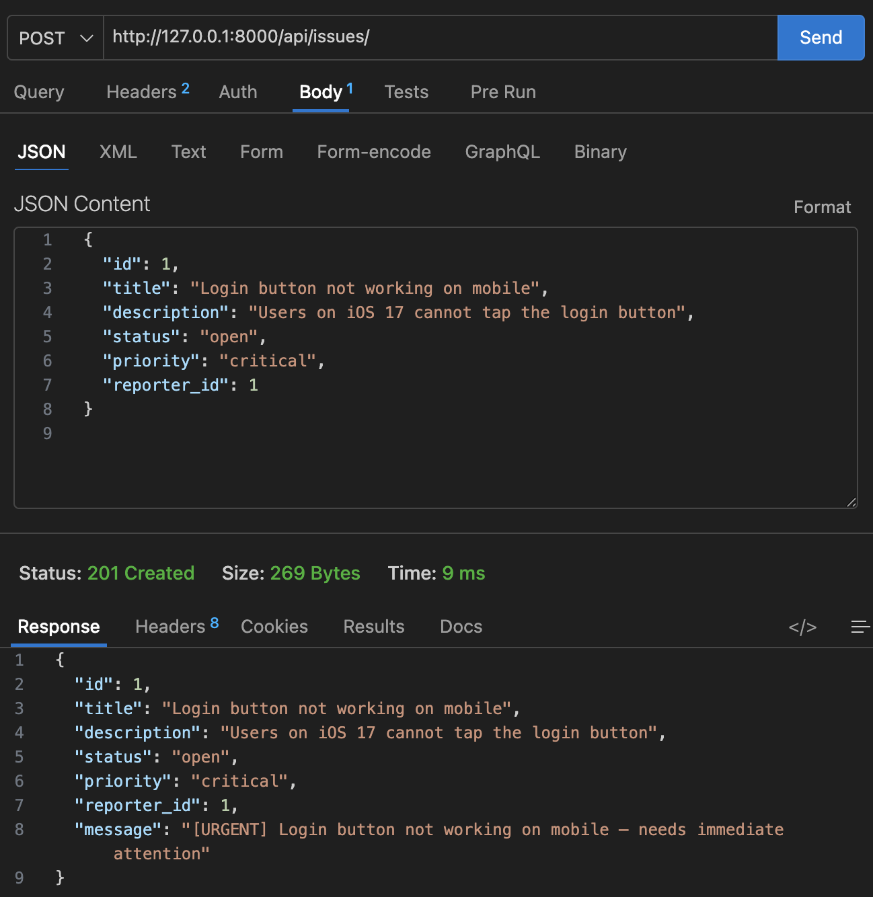
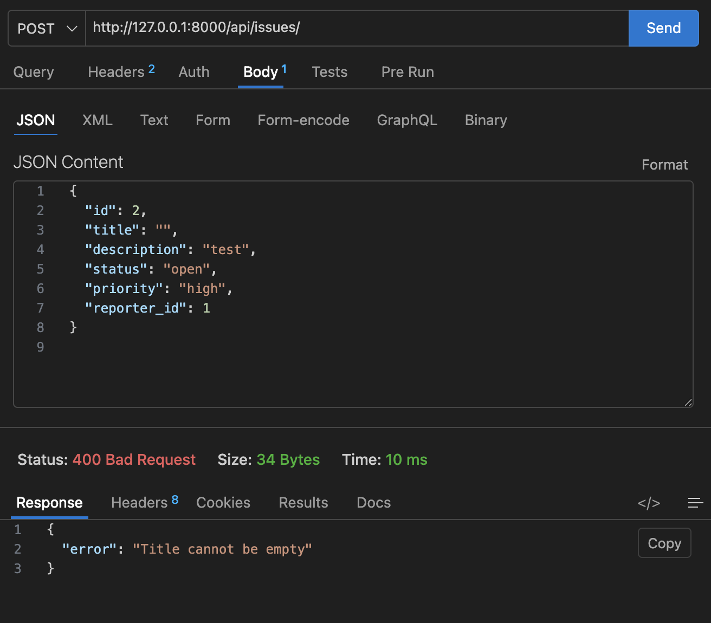
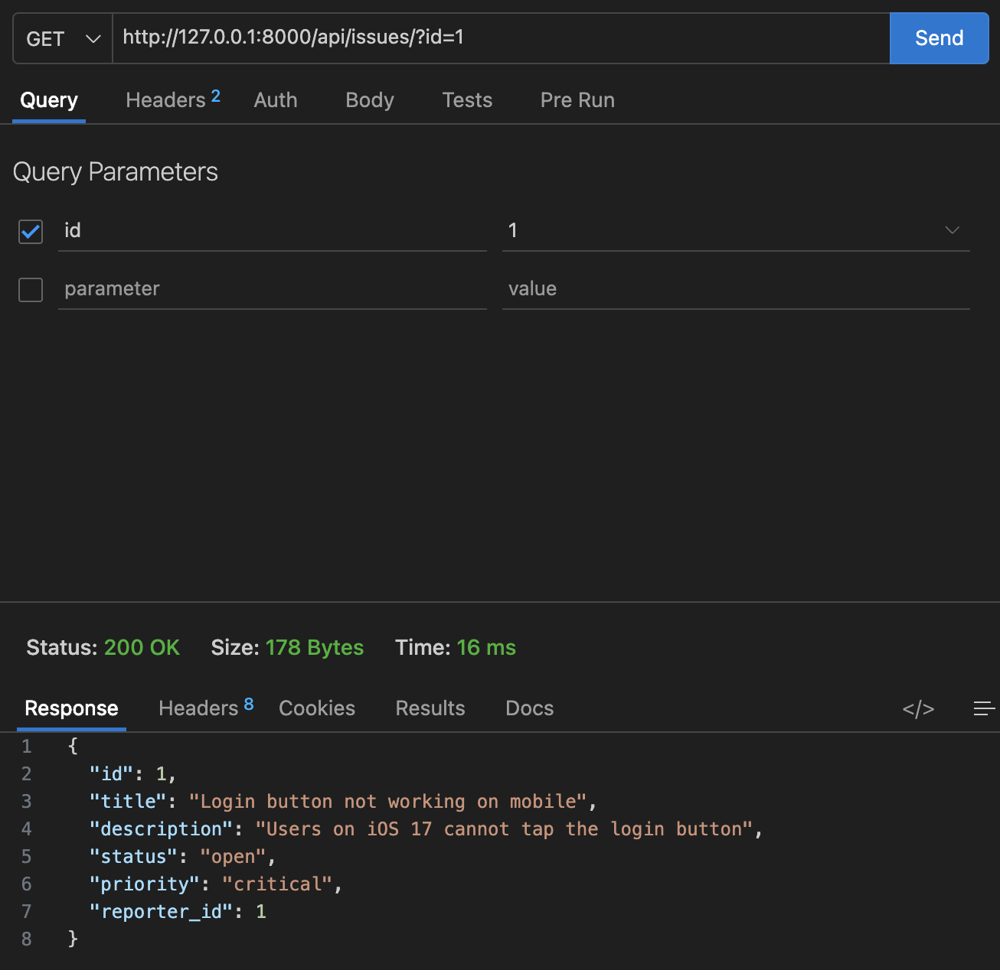
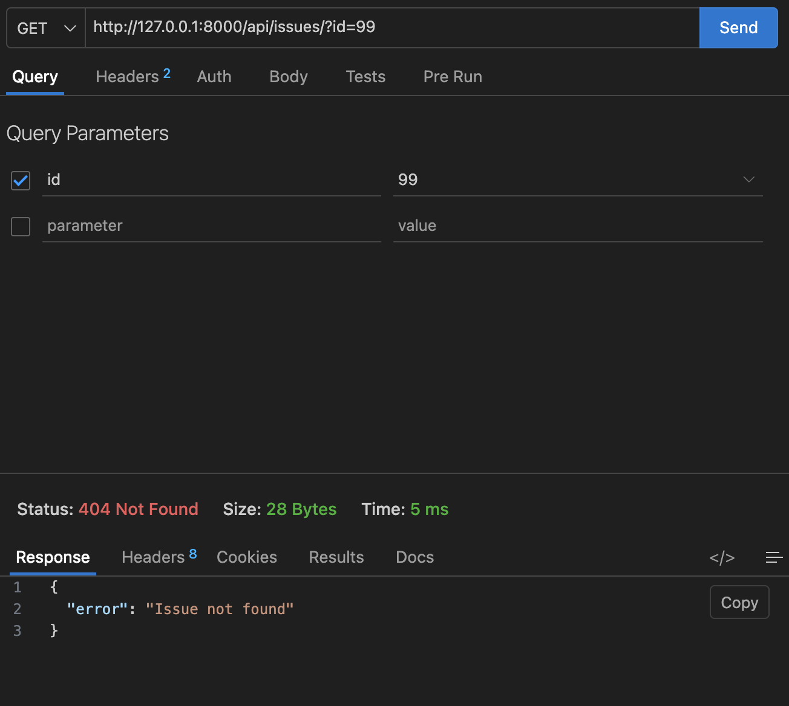

# DevTrack — Engineering Issue Tracker API

A backend API for tracking engineering issues. Engineers can report bugs, assign priorities, and track status — like a stripped-down GitHub Issues.

## How to Run

1. Clone the repository
2. Create and activate a virtual environment:
   ```
   python3 -m venv venv
   source venv/bin/activate
   ```
3. Install Django:
   ```
   pip install django
   ```
4. Run the server:
   ```
   python manage.py runserver
   ```
5. The API will be available at `http://127.0.0.1:8000/api/`

## Endpoints

### Reporter Endpoints

| Method | URL | Description |
|--------|-----|-------------|
| POST | `/api/reporters/` | Create a new reporter |
| GET | `/api/reporters/` | Get all reporters |
| GET | `/api/reporters/?id=1` | Get a single reporter by ID |

### Issue Endpoints

| Method | URL | Description |
|--------|-----|-------------|
| POST | `/api/issues/` | Create a new issue |
| GET | `/api/issues/` | Get all issues |
| GET | `/api/issues/?id=1` | Get a single issue by ID |
| GET | `/api/issues/?status=open` | Filter issues by status |

## Postman Screenshots

### 1. POST Reporter — 201 Created


### 2. POST Reporter — 400 Bad Request (empty name)


### 3. POST Issue (Critical) — 201 Created


### 4. POST Issue — 400 Bad Request (empty title)


### 5. GET Issue by ID — 200 OK


### 6. GET Issue — 404 Not Found


## Design Decision

I used JSON files (`issues.json` and `reporters.json`) for data storage instead of Django's built-in ORM and database models. This was a deliberate choice to keep the focus on OOP design — the `BaseEntity`, `Reporter`, `Issue`, `CriticalIssue`, and `LowPriorityIssue` classes handle all validation and data logic through inheritance and method overriding, without relying on Django's model layer. It keeps the project simple and makes the OOP concepts (abstract classes, inheritance, polymorphism via `describe()`) more visible.
